# Design

- **Figma:** [LIMIO — Protótipo Real](https://www.figma.com/design/mksrtupXi3Xs9uNeT0zKCw/LIMIO---PROTOTIPO-REAL?node-id=0-1)
- **Card:** [ETI-20](https://kaueamaral96.atlassian.net/browse/ETI-20) · Prototipação de alta fidelidade (concluído na Sprint 4)
- **Telas:** 90 telas de app, numeradas de 01 a 46. As variações de uma mesma tela levam letra (14a, 14b, 22b, 32h...): estados vazios, erros, confirmações e menus.
- **Versão:** exportação do Figma de 27/10/2026, com 54 telas atualizadas e 36 novas.
- **Plataforma de referência:** iPhone 393 × 852

## Fundamentos

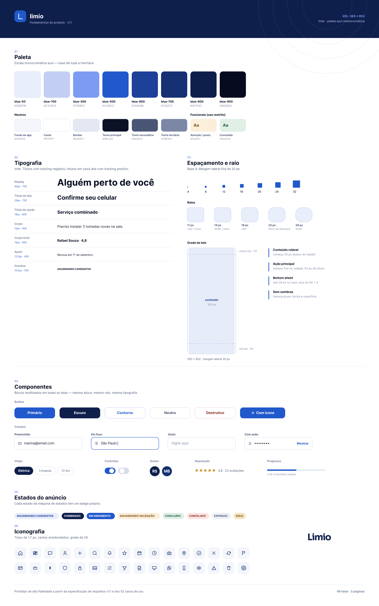

| Fundamento | Definição |
| --- | --- |
| Paleta | Azul monocromático, de `blue-50` `#E9EEFB` a `blue-900` `#060B20`; ação principal em `blue-500` `#2159CC`. Cores funcionais de uso restrito: atenção/prazo `#7A4A11` e concluído `#1D5A3C`. |
| Neutros | Fundo do app `#F4F6FB`, cards `#FFFFFF`, bordas `#E3E8F3`, texto principal `#0B1226`, secundário `#4A5675`, terciário `#7B87A4`. |
| Tipografia | Inter. Display 40 px/700, título de tela 26 px/700, título de seção 19 px/600, corpo 15 px/400, apoio 12,5 px/400, overline 10,5 px/700 em caixa alta. |
| Espaçamento | Base 4 (4, 8, 12, 16, 20, 24, 32). Margem lateral fixa de 20 px. |
| Raios | 11 px chip/ícone, 14 px botão/campo, 18 px card, 22 px bloco de destaque, 28 px bottom sheet. |
| Grade | Ação principal sempre fixa no rodapé (54 px de altura). Sem sombras: hierarquia por borda e superfície. |
| Componentes | Botões (primário, escuro, contorno, neutro, destrutivo, com ícone), campos (preenchido, em foco, vazio, com ação), chips, controles, avatar, reputação e barra de progresso. |
| Estados do anúncio | Um selo por estado: aguardando candidatos, combinado, em andamento, aguardando validação, concluído, cancelado, expirado e GOLD. |
| Iconografia | Traço de 1,7 px, cantos arredondados, grade de 24. |

## Mapa das telas

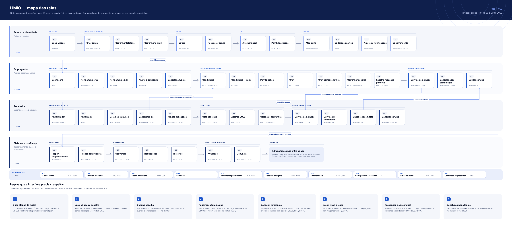

O mapa liga cada tela ao requisito (RF) ou caso de uso (UC) que ela materializa e mostra as regras que a interface precisa respeitar.

## Telas por módulo

| Módulo | Numeração | Telas | Pasta | Visão geral |
| --- | --- | --- | --- | --- |
| Acesso e identidade | 01 a 12 | 14 (1 nova) | [`telas/1-acesso-e-identidade/`](telas/1-acesso-e-identidade/) | [imagem](modulos/1-acesso-e-identidade.png) |
| Empregador | 13 a 27 | 38 (20 novas) | [`telas/2-empregador/`](telas/2-empregador/) | [imagem](modulos/2-empregador.png) |
| Prestador | 28 a 39 | 26 (11 novas) | [`telas/3-prestador/`](telas/3-prestador/) | [imagem](modulos/3-prestador.png) |
| Confiança e moderação | 40 a 46 | 12 (4 novas) | [`telas/4-confianca-e-moderacao/`](telas/4-confianca-e-moderacao/) | [imagem](modulos/4-confianca-e-moderacao.png) |
| **Total** | | **90 (36 novas)** | | |

Cada tela tem o mesmo número usado nos cards do Jira (por exemplo, o card ETI-74 cita `28-mural.png`), para quem desenvolve achar a tela do card.

## Prévia

| | | | |
| --- | --- | --- | --- |
| 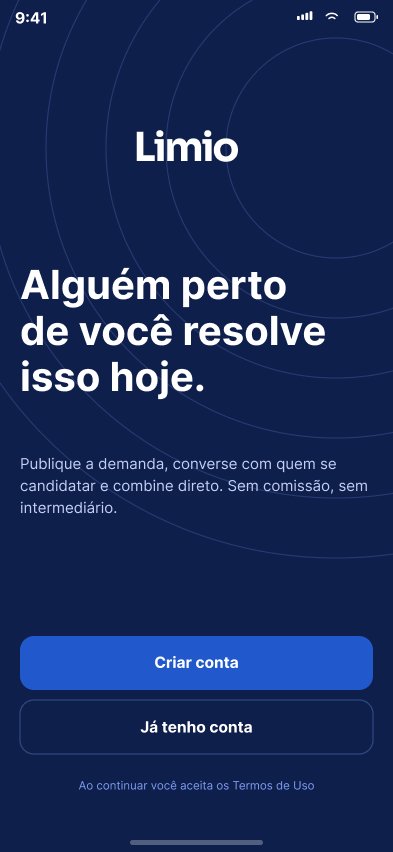 |  |  | 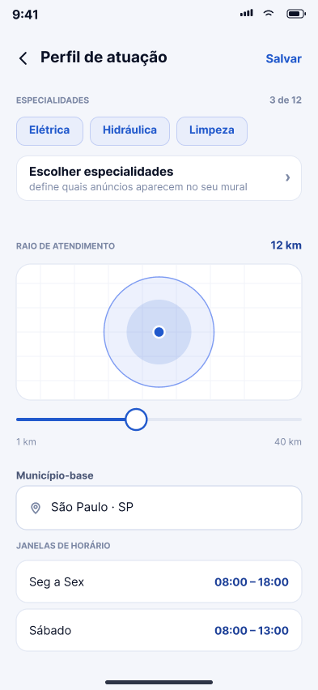 |
| 01 Boas-vindas | 05 Entrar | 08b Meu perfil (Prestador) | 10 Perfil de atuação |
| 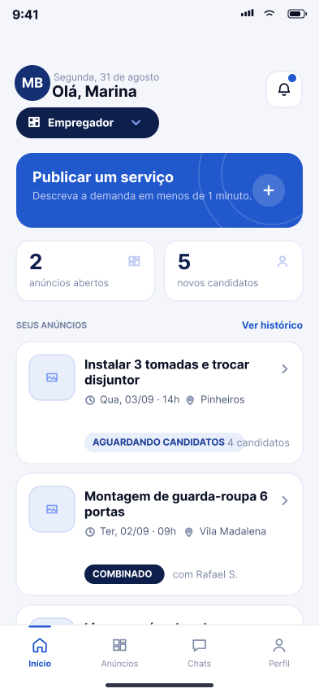 | 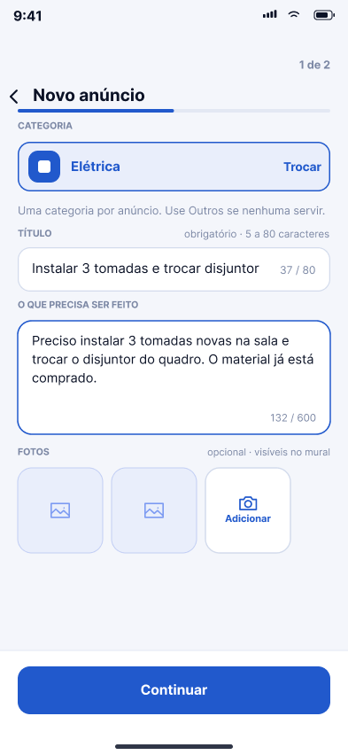 | 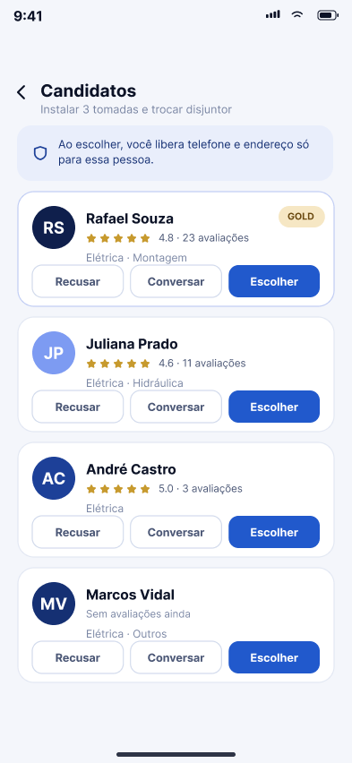 | 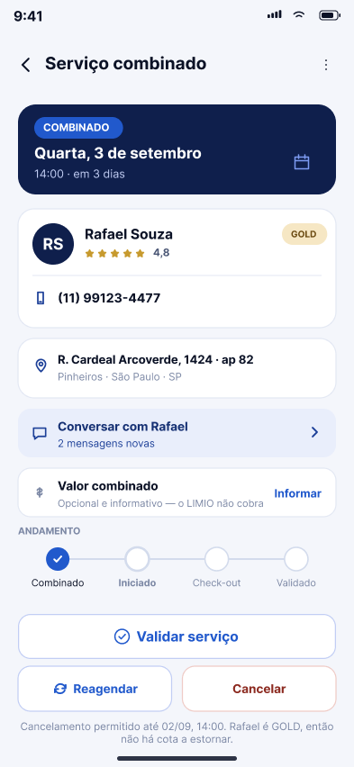 |
| 13 Início do Empregador | 14 Novo anúncio | 18 Candidatos | 25 Serviço combinado |
| 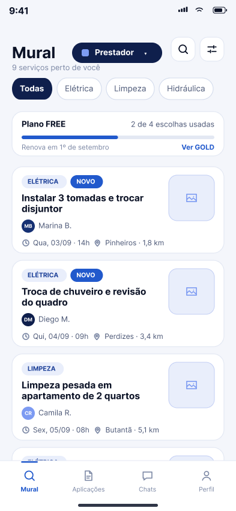 | 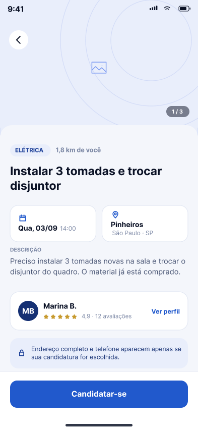 | 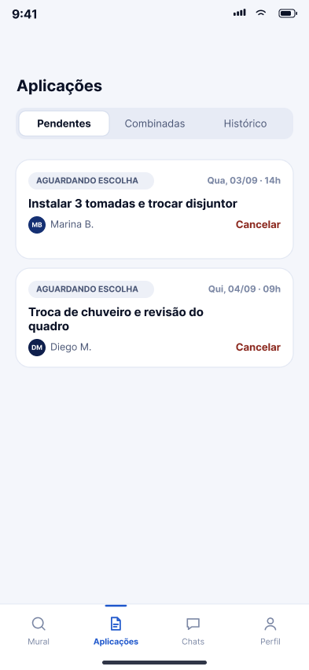 | 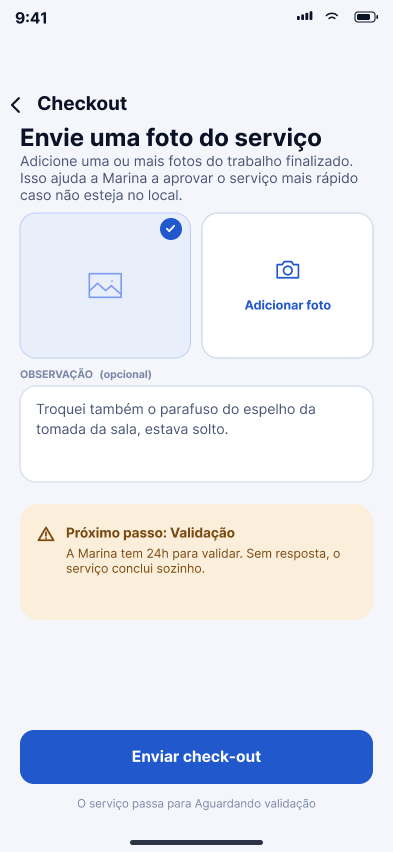 |
| 28 Mural | 30 Detalhe do anúncio | 32a Aplicações | 38 Check-out com foto |
|  | 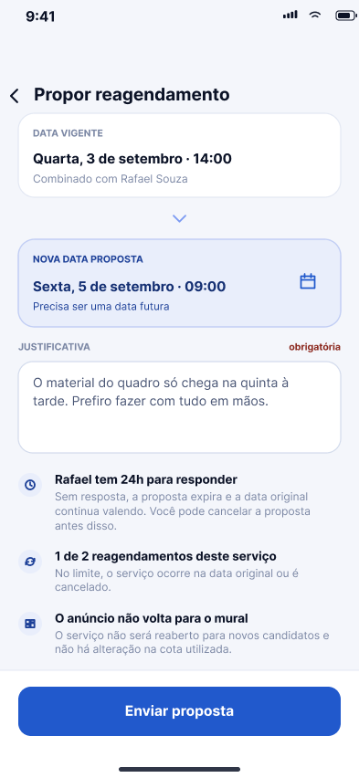 |  | 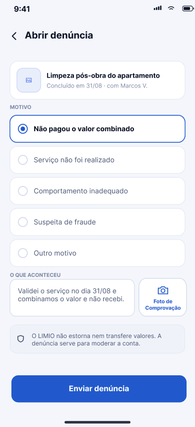 |
| 21 Chat | 40 Propor reagendamento | 45 Avaliação | 46 Denúncia |

## Todas as telas

### Acesso e identidade

| Tela | Nome | Arquivo | |
| --- | --- | --- | --- |
| 01 | Boas-vindas | [`01-boas-vindas.png`](telas/1-acesso-e-identidade/01-boas-vindas.png) |  |
| 02 | Criar conta | [`02-criar-conta.png`](telas/1-acesso-e-identidade/02-criar-conta.png) |  |
| 03 | Confirmar telefone | [`03-confirmar-telefone.png`](telas/1-acesso-e-identidade/03-confirmar-telefone.png) |  |
| 04 | Confirmar e-mail | [`04-confirmar-email.png`](telas/1-acesso-e-identidade/04-confirmar-email.png) |  |
| 05 | Entrar | [`05-entrar.png`](telas/1-acesso-e-identidade/05-entrar.png) |  |
| 06 | Recuperar senha | [`06-recuperar-senha.png`](telas/1-acesso-e-identidade/06-recuperar-senha.png) |  |
| 07 | Trocar papel | [`07-trocar-papel.png`](telas/1-acesso-e-identidade/07-trocar-papel.png) |  |
| 07a | Alterar senha | [`07a-alterar-senha.png`](telas/1-acesso-e-identidade/07a-alterar-senha.png) |  |
| 08 | Meu perfil | [`08-meu-perfil.png`](telas/1-acesso-e-identidade/08-meu-perfil.png) |  |
| 08b | Meu perfil (Prestador) | [`08b-perfil-prestador.png`](telas/1-acesso-e-identidade/08b-perfil-prestador.png) | nova |
| 09 | Endereços salvos | [`09-enderecos-salvos.png`](telas/1-acesso-e-identidade/09-enderecos-salvos.png) |  |
| 10 | Perfil de atuação | [`10-perfil-atuacao.png`](telas/1-acesso-e-identidade/10-perfil-atuacao.png) |  |
| 11 | Ajustes | [`11-ajustes.png`](telas/1-acesso-e-identidade/11-ajustes.png) |  |
| 12 | Encerrar conta | [`12-encerrar-conta.png`](telas/1-acesso-e-identidade/12-encerrar-conta.png) |  |

### Empregador

| Tela | Nome | Arquivo | |
| --- | --- | --- | --- |
| 13 | Início do Empregador | [`13-dashboard-empregador.png`](telas/2-empregador/13-dashboard-empregador.png) |  |
| 13b | Início — aviso de anúncio cancelado | [`13b-dashboard-anuncio-cancelado.png`](telas/2-empregador/13b-dashboard-anuncio-cancelado.png) | nova |
| 14 | Novo anúncio — passo 1 | [`14-novo-anuncio-1.png`](telas/2-empregador/14-novo-anuncio-1.png) |  |
| 14a | Escolher categoria | [`14a-escolher-categoria.png`](telas/2-empregador/14a-escolher-categoria.png) |  |
| 14b | Novo anúncio — erro no título | [`14b-novo-anuncio-1-erro-titulo.png`](telas/2-empregador/14b-novo-anuncio-1-erro-titulo.png) | nova |
| 14c | Novo anúncio — adicionar foto | [`14c-novo-anuncio-1-adicionar-foto.png`](telas/2-empregador/14c-novo-anuncio-1-adicionar-foto.png) | nova |
| 15 | Novo anúncio — passo 2 | [`15-novo-anuncio-2.png`](telas/2-empregador/15-novo-anuncio-2.png) |  |
| 16 | Anúncio publicado | [`16-anuncio-publicado.png`](telas/2-empregador/16-anuncio-publicado.png) |  |
| 16a | Editar anúncio | [`16a-editar-anuncio.png`](telas/2-empregador/16a-editar-anuncio.png) |  |
| 16b | Anúncio publicado, sem candidatos | [`16b-anuncio-publicado-sem-candidatos.png`](telas/2-empregador/16b-anuncio-publicado-sem-candidatos.png) | nova |
| 16c | Anúncio publicado — menu | [`16c-anuncio-publicado-menu.png`](telas/2-empregador/16c-anuncio-publicado-menu.png) | nova |
| 17 | Cancelar anúncio | [`17-cancelar-anuncio.png`](telas/2-empregador/17-cancelar-anuncio.png) |  |
| 17b | Cancelar anúncio sem candidatos | [`17b-cancelar-anuncio-sem-candidatos.png`](telas/2-empregador/17b-cancelar-anuncio-sem-candidatos.png) | nova |
| 18 | Candidatos | [`18-candidatos.png`](telas/2-empregador/18-candidatos.png) |  |
| 18b | Confirmar recusa de candidato | [`18b-candidatos-confirmar-recusa.png`](telas/2-empregador/18b-candidatos-confirmar-recusa.png) | nova |
| 18c | Candidatura recusada | [`18c-candidatos-candidatura-recusada.png`](telas/2-empregador/18c-candidatos-candidatura-recusada.png) | nova |
| 19 | Candidatos — vazio | [`19-candidatos-vazio.png`](telas/2-empregador/19-candidatos-vazio.png) |  |
| 20a | Perfil público do candidato | [`20a-perfil-publico-candidato.png`](telas/2-empregador/20a-perfil-publico-candidato.png) |  |
| 20b | Perfil público — consulta | [`20b-perfil-publico-consulta.png`](telas/2-empregador/20b-perfil-publico-consulta.png) |  |
| 21 | Chat | [`21-chat.png`](telas/2-empregador/21-chat.png) |  |
| 21b | Chat — menu | [`21b-chat-menu.png`](telas/2-empregador/21b-chat-menu.png) | nova |
| 22 | Chat somente leitura | [`22-chat-somente-leitura.png`](telas/2-empregador/22-chat-somente-leitura.png) |  |
| 22b | Chat somente leitura — candidato recusado | [`22b-chat-somente-leitura-recusado.png`](telas/2-empregador/22b-chat-somente-leitura-recusado.png) | nova |
| 22c | Chat somente leitura — candidato desistiu | [`22c-chat-somente-leitura-desistiu.png`](telas/2-empregador/22c-chat-somente-leitura-desistiu.png) | nova |
| 22d | Chat somente leitura — anúncio cancelado | [`22d-chat-somente-leitura-anuncio-cancelado.png`](telas/2-empregador/22d-chat-somente-leitura-anuncio-cancelado.png) | nova |
| 22e | Chat somente leitura — serviço cancelado | [`22e-chat-somente-leitura-servico-cancelado.png`](telas/2-empregador/22e-chat-somente-leitura-servico-cancelado.png) | nova |
| 23 | Confirmar escolha | [`23-confirmar-escolha.png`](telas/2-empregador/23-confirmar-escolha.png) |  |
| 24 | Escolha recusada por cota | [`24-escolha-recusada.png`](telas/2-empregador/24-escolha-recusada.png) |  |
| 25 | Serviço combinado | [`25-servico-combinado.png`](telas/2-empregador/25-servico-combinado.png) |  |
| 25b | Serviço aguardando validação | [`25b-servico-aguardando-validacao.png`](telas/2-empregador/25b-servico-aguardando-validacao.png) | nova |
| 25c | Serviço concluído | [`25c-servico-concluido.png`](telas/2-empregador/25c-servico-concluido.png) | nova |
| 25d | Serviço encerrado | [`25d-servico-encerrado.png`](telas/2-empregador/25d-servico-encerrado.png) | nova |
| 25e | Serviço em andamento | [`25e-servico-em-andamento.png`](telas/2-empregador/25e-servico-em-andamento.png) | nova |
| 25f | Serviço combinado — menu | [`25f-servico-combinado-menu.png`](telas/2-empregador/25f-servico-combinado-menu.png) | nova |
| 26 | Cancelar serviço combinado | [`26-cancelar-combinado.png`](telas/2-empregador/26-cancelar-combinado.png) |  |
| 27 | Validar serviço | [`27-validar-servico.png`](telas/2-empregador/27-validar-servico.png) |  |
| 27b | Validar serviço presencialmente | [`27b-validar-servico-presencial.png`](telas/2-empregador/27b-validar-servico-presencial.png) | nova |
| 27c | Validar serviço sem valor combinado | [`27c-validar-servico-sem-valor.png`](telas/2-empregador/27c-validar-servico-sem-valor.png) | nova |

### Prestador

| Tela | Nome | Arquivo | |
| --- | --- | --- | --- |
| 28 | Mural | [`28-mural.png`](telas/3-prestador/28-mural.png) |  |
| 28a | Filtros do mural | [`28a-filtros-mural.png`](telas/3-prestador/28a-filtros-mural.png) |  |
| 28b | Busca no mural | [`28b-mural-busca.png`](telas/3-prestador/28b-mural-busca.png) | nova |
| 28c | Mural do Prestador GOLD | [`28c-mural-gold.png`](telas/3-prestador/28c-mural-gold.png) | nova |
| 29 | Mural vazio | [`29-mural-vazio.png`](telas/3-prestador/29-mural-vazio.png) |  |
| 30 | Detalhe do anúncio | [`30-detalhe-anuncio.png`](telas/3-prestador/30-detalhe-anuncio.png) |  |
| 30b | Detalhe do anúncio — candidatura enviada | [`30b-detalhe-anuncio-candidatura-enviada.png`](telas/3-prestador/30b-detalhe-anuncio-candidatura-enviada.png) | nova |
| 31 | Candidatar-se | [`31-candidatar-se.png`](telas/3-prestador/31-candidatar-se.png) |  |
| 32a | Aplicações — pendentes | [`32a-aplicacoes-pendentes.png`](telas/3-prestador/32a-aplicacoes-pendentes.png) |  |
| 32b | Aplicações — combinadas | [`32b-aplicacoes-combinadas.png`](telas/3-prestador/32b-aplicacoes-combinadas.png) |  |
| 32c | Aplicações — histórico | [`32c-aplicacoes-historico.png`](telas/3-prestador/32c-aplicacoes-historico.png) |  |
| 32d | Confirmar desistência | [`32d-aplicacoes-confirmar-desistencia.png`](telas/3-prestador/32d-aplicacoes-confirmar-desistencia.png) | nova |
| 32e | Aplicações pendentes — vazio | [`32e-aplicacoes-pendentes-vazio.png`](telas/3-prestador/32e-aplicacoes-pendentes-vazio.png) | nova |
| 32f | Aplicações combinadas — vazio | [`32f-aplicacoes-combinadas-vazio.png`](telas/3-prestador/32f-aplicacoes-combinadas-vazio.png) | nova |
| 32g | Histórico de aplicações — vazio | [`32g-aplicacoes-historico-vazio.png`](telas/3-prestador/32g-aplicacoes-historico-vazio.png) | nova |
| 32h | Histórico — detalhe do serviço | [`32h-aplicacoes-historico-detalhe.png`](telas/3-prestador/32h-aplicacoes-historico-detalhe.png) | nova |
| 33 | Cota do mês esgotada | [`33-cota-esgotada.png`](telas/3-prestador/33-cota-esgotada.png) |  |
| 33b | Cota do mês parcial | [`33b-cota-do-mes-parcial.png`](telas/3-prestador/33b-cota-do-mes-parcial.png) | nova |
| 34 | Assinar GOLD | [`34-assinar-gold.png`](telas/3-prestador/34-assinar-gold.png) |  |
| 35 | Gerenciar assinatura GOLD | [`35-gerenciar-gold.png`](telas/3-prestador/35-gerenciar-gold.png) |  |
| 36 | Serviço combinado (Prestador) | [`36-combinado-prestador.png`](telas/3-prestador/36-combinado-prestador.png) |  |
| 36b | Confirmar início do serviço | [`36b-iniciar-servico-confirmar.png`](telas/3-prestador/36b-iniciar-servico-confirmar.png) | nova |
| 37 | Serviço em andamento | [`37-servico-em-andamento.png`](telas/3-prestador/37-servico-em-andamento.png) |  |
| 38 | Check-out com foto | [`38-check-out.png`](telas/3-prestador/38-check-out.png) |  |
| 38b | Check-out — adicionar foto | [`38b-check-out-adicionar-foto.png`](telas/3-prestador/38b-check-out-adicionar-foto.png) | nova |
| 39 | Cancelar serviço (Prestador) | [`39-cancelar-prestador.png`](telas/3-prestador/39-cancelar-prestador.png) |  |

### Confiança e moderação

| Tela | Nome | Arquivo | |
| --- | --- | --- | --- |
| 40 | Propor reagendamento | [`40-propor-reagendamento.png`](telas/4-confianca-e-moderacao/40-propor-reagendamento.png) |  |
| 41 | Responder reagendamento | [`41-responder-reagendamento.png`](telas/4-confianca-e-moderacao/41-responder-reagendamento.png) |  |
| 42 | Conversas | [`42-conversas.png`](telas/4-confianca-e-moderacao/42-conversas.png) |  |
| 42b | Conversas (Prestador) | [`42b-conversas-prestador.png`](telas/4-confianca-e-moderacao/42b-conversas-prestador.png) |  |
| 43 | Notificações | [`43-notificacoes.png`](telas/4-confianca-e-moderacao/43-notificacoes.png) |  |
| 44 | Histórico | [`44-historico.png`](telas/4-confianca-e-moderacao/44-historico.png) |  |
| 45 | Avaliação | [`45-avaliacao.png`](telas/4-confianca-e-moderacao/45-avaliacao.png) |  |
| 45b | Avaliação — nota regular | [`45b-avaliacao-nota-regular.png`](telas/4-confianca-e-moderacao/45b-avaliacao-nota-regular.png) | nova |
| 45c | Avaliação enviada (Empregador) | [`45c-avaliacao-enviada-empregador.png`](telas/4-confianca-e-moderacao/45c-avaliacao-enviada-empregador.png) | nova |
| 45d | Avaliação enviada (Prestador) | [`45d-avaliacao-enviada-prestador.png`](telas/4-confianca-e-moderacao/45d-avaliacao-enviada-prestador.png) | nova |
| 45e | Avaliação feita pelo Prestador | [`45e-avaliacao-prestador.png`](telas/4-confianca-e-moderacao/45e-avaliacao-prestador.png) | nova |
| 46 | Denúncia | [`46-denuncia.png`](telas/4-confianca-e-moderacao/46-denuncia.png) |  |
