# System Design — LIMIO

> Versão de **27/10/2026**, conferida contra o código de `limio-api` (branch `develop`, último commit de 27/10) e `limio-app` (branch `develop`, último commit de 27/10).
> O que ainda não está no código aparece marcado como **planejado** ou **a definir**.

## Sumário

1. [O que o sistema faz](#1-o-que-o-sistema-faz)
2. [Requisitos que mais pesam na arquitetura](#2-requisitos-que-mais-pesam-na-arquitetura)
3. [Visão de contexto](#3-visão-de-contexto)
4. [Containers e tecnologias](#4-containers-e-tecnologias)
5. [Back-end: monolito modular por domínio](#5-back-end-monolito-modular-por-domínio)
6. [Comunicação entre módulos](#6-comunicação-entre-módulos)
7. [App mobile: MVVM por módulo](#7-app-mobile-mvvm-por-módulo)
8. [Fluxos principais](#8-fluxos-principais)
9. [Dados](#9-dados)
10. [Estados do anúncio e da candidatura](#10-estados-do-anúncio-e-da-candidatura)
11. [Segurança e LGPD](#11-segurança-e-lgpd)
12. [Infraestrutura e deploy](#12-infraestrutura-e-deploy)
13. [Decisões e alternativas](#13-decisões-e-alternativas)
14. [Pontos em aberto](#14-pontos-em-aberto)

---

## 1. O que o sistema faz

O LIMIO conecta quem precisa de um serviço pontual (**Empregador**) a prestadores próximos (**Prestador**).

1. O Empregador publica um anúncio, sem valor.
2. Prestadores compatíveis (especialidade e raio de atendimento) veem o anúncio no mural e se candidatam.
3. A candidatura abre um chat 1:1 para combinar escopo e valor.
4. O Empregador escolhe um candidato. Só o escolhido recebe telefone e endereço completo.
5. O serviço é iniciado, entregue com foto, validado e avaliado.

O pagamento do serviço acontece fora da plataforma. O único produto pago é a assinatura **GOLD**, que tira o limite de 4 escolhas por mês do Prestador no plano FREE. Uma mesma conta (CPF + e-mail) atua nos dois papéis.

## 2. Requisitos que mais pesam na arquitetura

| Requisito | Impacto no desenho |
| --- | --- |
| Uma conta, dois papéis | Papel ativo guardado no usuário (`papelAtivo`) e trocado sem novo login. |
| Contatos só depois da escolha | O mural e a lista de candidatos nunca devolvem telefone, e-mail ou endereço completo. A liberação acontece na transação da escolha. |
| Escolha única e atômica | Duas escolhas ao mesmo tempo no mesmo anúncio: só a primeira vale (409). Cota FREE consumida na mesma transação. |
| Chat em tempo real | WebSocket na própria API (`spring-boot-starter-websocket`; `@stomp/stompjs` no app). |
| LGPD | Encerramento de conta com anonimização em vários módulos, bloqueio de CPF por 12 meses, retenção com limpeza diária, remoção de EXIF das fotos. |
| Anti-enumeração | Login, cadastro duplicado e recuperação de senha respondem de forma genérica. |
| Proteção contra abuso | Limite de tentativas de login por e-mail e por IP, limite de reenvio de código e de links. |
| Proximidade | Endereços geocodificados (latitude/longitude) para calcular a distância até o raio do Prestador. |

## 3. Visão de contexto

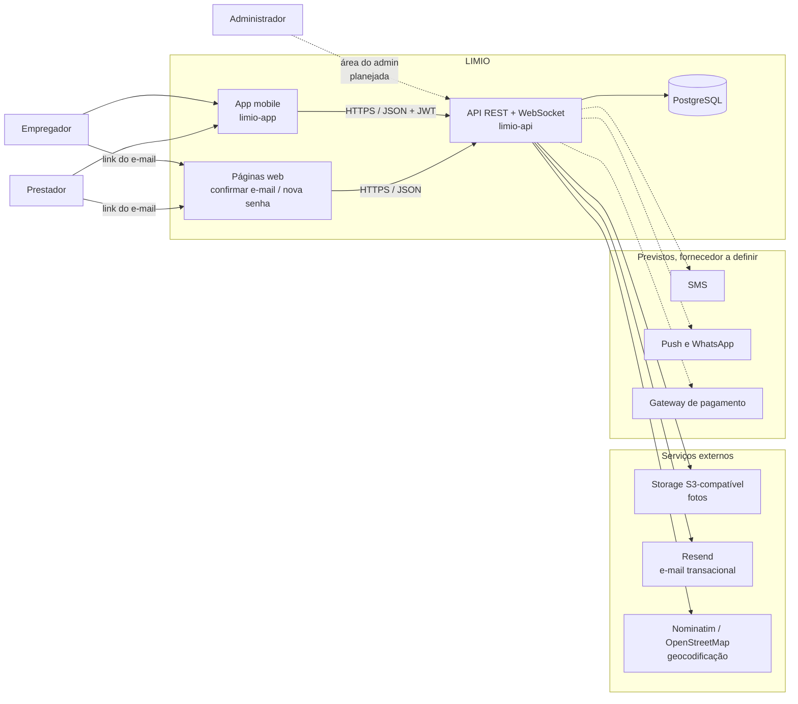

Linhas tracejadas: integrações previstas nos cards, ainda sem fornecedor escolhido.

## 4. Containers e tecnologias

| Container | Tecnologia | Responsabilidade |
| --- | --- | --- |
| **limio-app** | Expo SDK 57, React Native 0.86, React 19, Expo Router, TanStack React Query, Zustand, NativeWind, React Hook Form, Zod, Axios, STOMP.js, Expo Notifications, React Native Maps, Expo Secure Store | Telas do Empregador e do Prestador, sessão do usuário, validação de formulários, chat. |
| **limio-api** | Java 21, Spring Boot (Web MVC, Security, Data JPA, Validation, WebSocket, Actuator), Flyway, JWT (Spring Security OAuth2 JOSE), SDK do Resend, AWS SDK S3, Testcontainers | Regras de negócio, autenticação, persistência, integrações e as páginas web dos links de e-mail. |
| **Páginas web** | HTML estático + JavaScript em `src/main/resources/static/paginas/`, servidas pela própria API ([ADR-0002](adr/0002-links-de-email-https-com-paginas-web.md)) | Concluir confirmação de e-mail e redefinição de senha no navegador. |
| **Banco** | PostgreSQL, versionado por migrations do Flyway (`V1` a `V19` hoje) | Dados de todos os módulos, um esquema só. |
| **Infraestrutura** | Railway, ambientes `development` e `production` | Hospedar API e banco, deploy automático por branch. |

## 5. Back-end: monolito modular por domínio

A API é um único serviço implantável, dividido em módulos de domínio isolados ([ADR-0001](adr/0001-arquitetura-modular-por-dominio.md)). Cada módulo segue Ports & Adapters (hexagonal) por dentro.

### Módulos

| Módulo | O que guarda | Situação no código |
| --- | --- | --- |
| `auth` | Usuário, sessão por aparelho, tentativas de login, verificação de contato, CPF bloqueado | Implementado |
| `perfil` | Perfil de Empregador, endereços salvos, perfil de atuação do Prestador, categorias, mídia (fotos), geocodificação | Implementado |
| `anuncio` | Anúncio, candidatura (aplicação), reagendamento | Em desenvolvimento (Sprint 6) |
| `notificacao` | Preferências de notificação | Parcial (envio nos canais é Sprint 7) |
| `chat` | Conversas e mensagens | Estrutura criada, implementação na Sprint 6 |
| `moderacao` | Denúncias, sanções, avaliações | Estrutura criada, Sprints 6 e 7 |
| `financeiro` | Assinatura GOLD, cobranças | Estrutura criada, Sprint 7 |
| `administracao` | Dashboard do admin | Estrutura criada, Sprint 7 |
| `privacidade` e `auditoria` | Exportação de dados e trilha de auditoria | Estrutura criada; o log de auditoria já existe em `comum/auditoria` |
| `comum/` | Configuração, segurança (JWT), erros (`ErroResponse` + `CodigoErro`), eventos e portas entre módulos | Implementado |

### Camadas dentro de um módulo

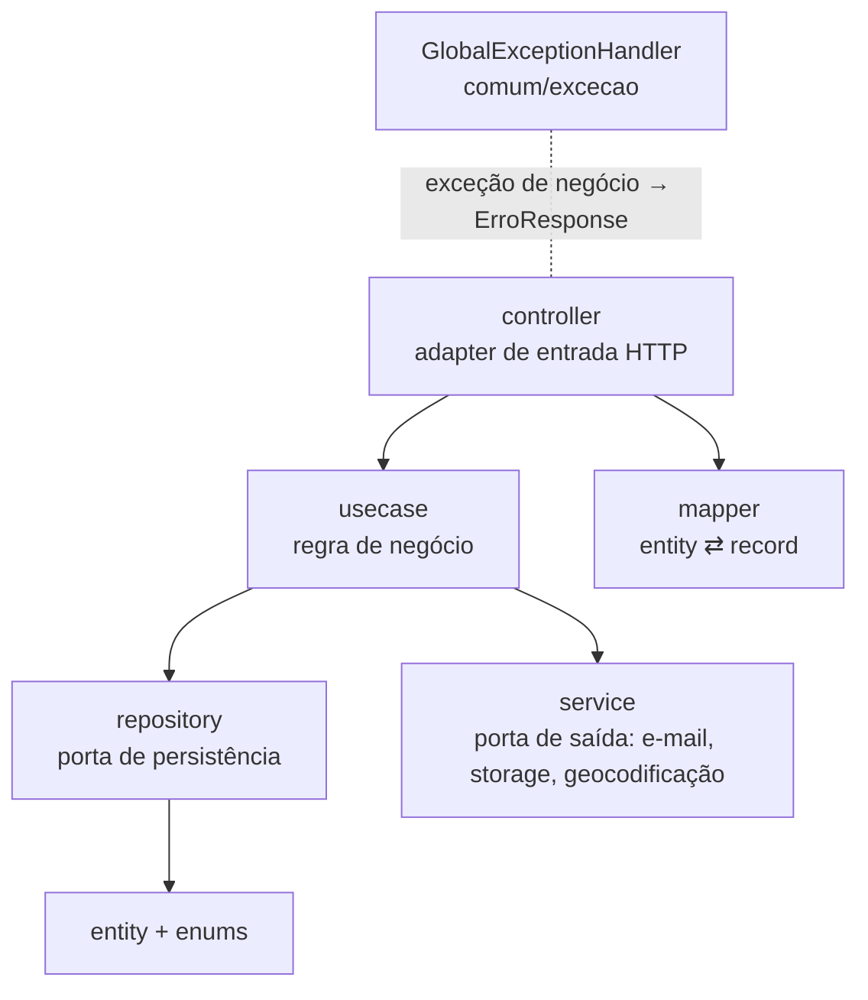

Regras fixas:

- O `usecase` não conhece HTTP nem os DTOs; quem converte é o `mapper`, chamado pelo `controller`.
- Contratos de entrada e saída são `record` imutáveis com Bean Validation.
- Status e tipos são sempre `enum`; nunca texto solto.
- Erros de negócio viram um `ErroResponse` com um `CodigoErro`, num único ponto (`GlobalExceptionHandler`).
- Testes: `spec/` (unidade, sem Spring) e `story/` (comportamento, com Spring e PostgreSQL real via Testcontainers).

## 6. Comunicação entre módulos

Um módulo nunca importa outro. Duas formas de conversar foram formalizadas no [ADR-0003](adr/0003-comunicacao-entre-modulos-eventos-e-portas.md): **eventos para reação, portas para consulta**.

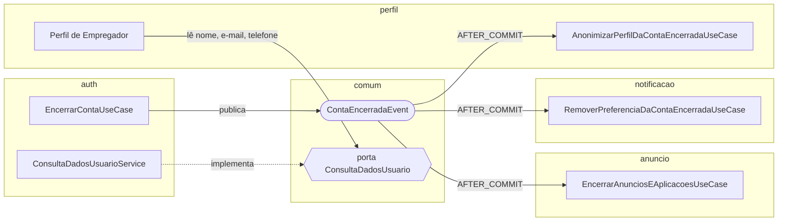

- **Evento** (`comum/eventos/`): quem reage roda depois do commit de quem publicou, numa transação própria. Uma falha no ouvinte é registrada e não desfaz a ação original.
- **Efeito externo** (e-mail, storage) sai sempre depois do commit, nunca dentro da transação.
- **Porta** (`comum/portas/`): interface só de leitura, que devolve um `record`. Hoje: `ConsultaDadosUsuario` e `ConsultaPerfilEmpregador`.
- No banco, tabelas de módulos diferentes se ligam por id (UUID), sem chave estrangeira entre módulos. Chaves estrangeiras só existem dentro do mesmo módulo.

## 7. App mobile: MVVM por módulo

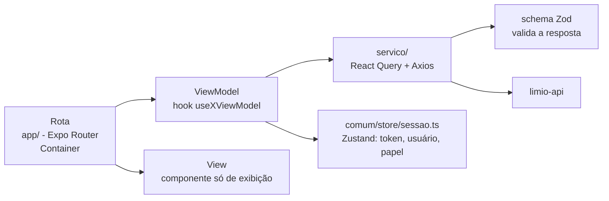

- Rotas em `app/` separadas por grupo: `(auth)`, `(app)/(contratante)` e `(app)/(prestador)`.
- Módulos em `src/modulos/`: hoje `auth`, `conta`, `perfil` e `anuncio`.
- Os tipos e enums do app espelham os records e enums da API; o `CodigoErro` é o mesmo dos dois lados.

## 8. Fluxos principais

### 8.1 Login e sessão (implementado)

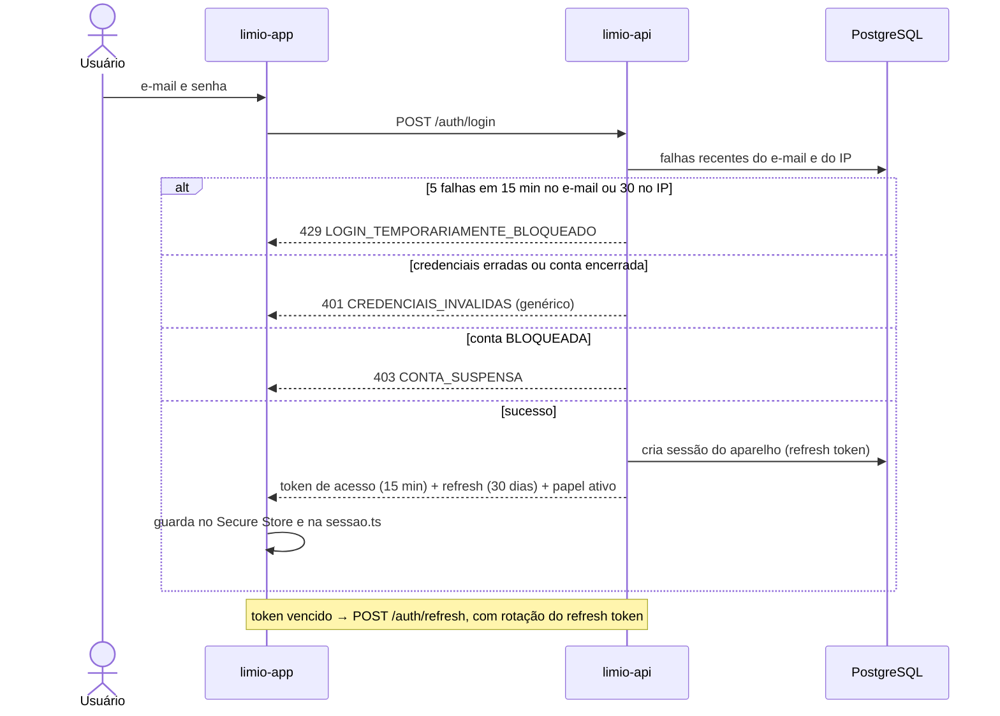

### 8.2 Confirmação de e-mail pelo navegador (implementado)

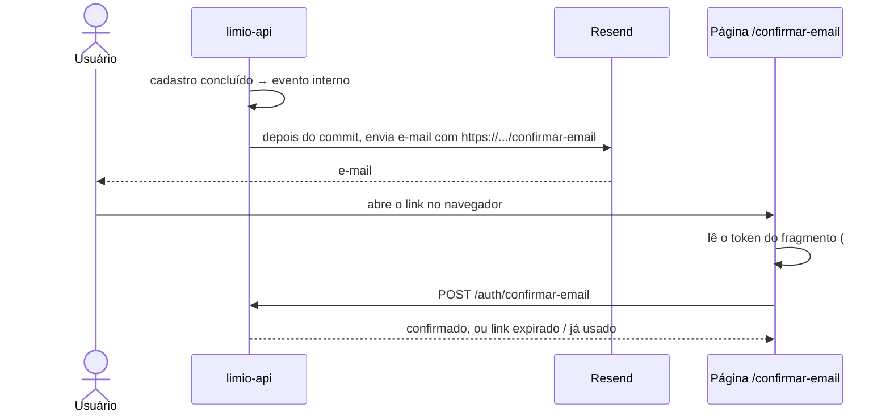

O token fica no fragmento (`#`), que o navegador nunca envia ao servidor. Assim ele não aparece em log de acesso nem no Referer.

### 8.3 Escolha do prestador (planejado — ETI-69)

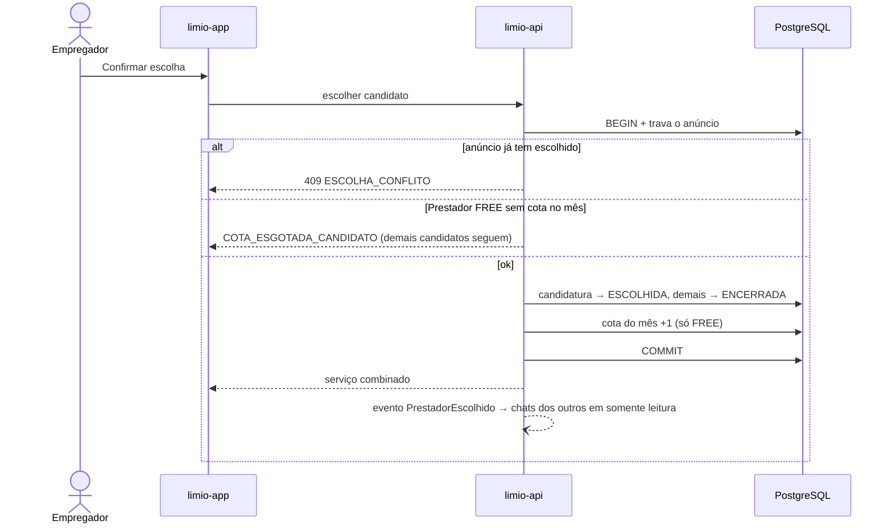

## 9. Dados

O modelo completo está no [DER](../artefatos/der/). Tabelas que já existem no banco, por módulo:

| Módulo | Tabelas |
| --- | --- |
| `auth` | `usuario`, `sessao`, `tentativa_login`, `verificacao_contato`, `cpf_bloqueado` |
| `perfil` | `perfil_empregador`, `endereco_salvo`, `perfil_prestador`, `prestador_categoria`, `categoria`, `janela_atendimento`, `midia` |
| `anuncio` | `anuncio`, `aplicacao`, `reagendamento` |
| `notificacao` | `preferencia_notificacao` |
| `comum` | `log_auditoria` |

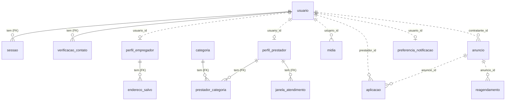

Linha cheia: chave estrangeira dentro do mesmo módulo. Linha tracejada: ligação por id entre módulos, sem chave estrangeira (regra do ADR-0001).

## 10. Estados do anúncio e da candidatura

Valores que estão hoje nos enums `StatusAnuncio` e `StatusAplicacao`.

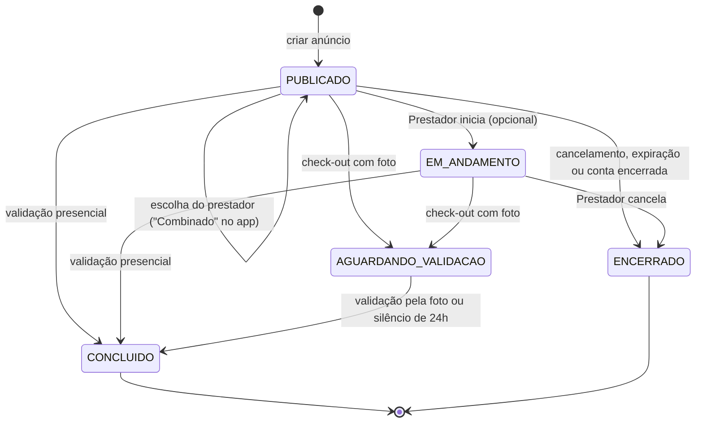

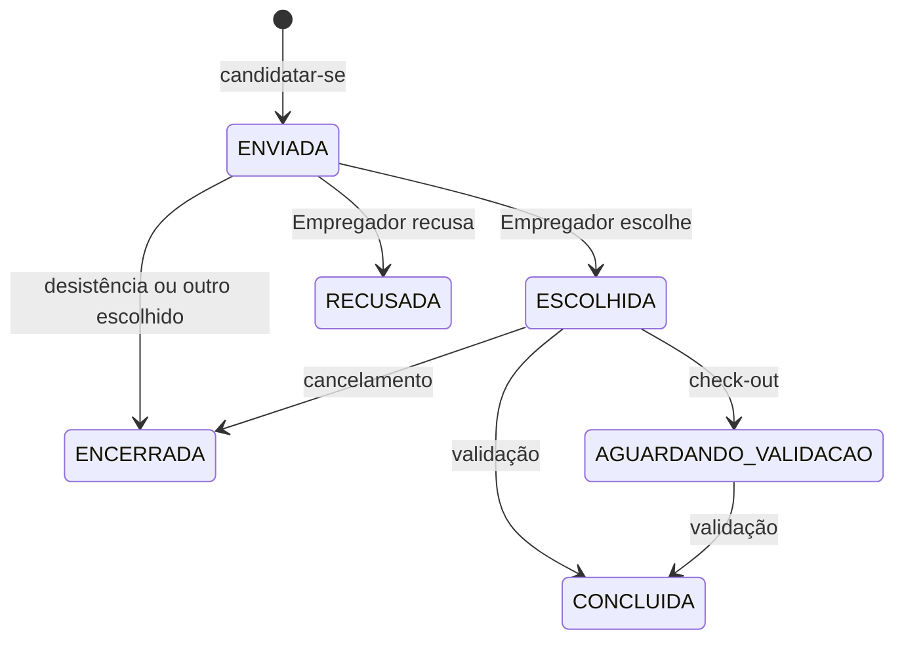

Os 13 fluxos completos, com raias e decisões, estão nos [diagramas de atividade](../artefatos/atividade/).

## 11. Segurança e LGPD

| Tema | Como está resolvido |
| --- | --- |
| Autenticação | JWT HS256 de 15 min + refresh token de 30 dias por aparelho, trocado a cada renovação. Logout revoga só o aparelho atual. |
| Senha | Hash BCrypt; 8 a 72 caracteres com letra e número. Troca ou redefinição encerra as outras sessões. |
| Força bruta | 5 falhas por e-mail em 15 min bloqueiam por 15 min; limite separado de 30 falhas por IP. O IP real é lido atrás do proxy da Railway sem confiar em cabeçalho forjado. |
| Anti-enumeração | Mesma resposta para e-mail inexistente, senha errada e conta encerrada; cadastro duplicado não diz qual campo colidiu. |
| Links de e-mail | Uso único, com validade (1 h para senha, 24 h para e-mail), token no fragmento `#`, páginas com Content-Security-Policy restritiva. |
| CPF | Guardado como hash HMAC-SHA256 no bloqueio de 12 meses após o encerramento. |
| Privacidade dos contatos | Telefone e endereço completo só para o Prestador escolhido. |
| Encerramento de conta | Anonimiza dados pessoais em todos os módulos (por evento), apaga fotos do storage, bloqueia o CPF, registra auditoria. |
| Retenção | Rotina diária às 3h: logs de auditoria após 5 anos, sessões após 180 dias, tentativas de login após 30 dias, bloqueios de CPF vencidos. |
| Fotos | Metadados de localização (EXIF) removidos no upload. |
| Segredos | Só em variáveis de ambiente da Railway; sem valor padrão, a API não sobe sem eles. |

## 12. Infraestrutura e deploy

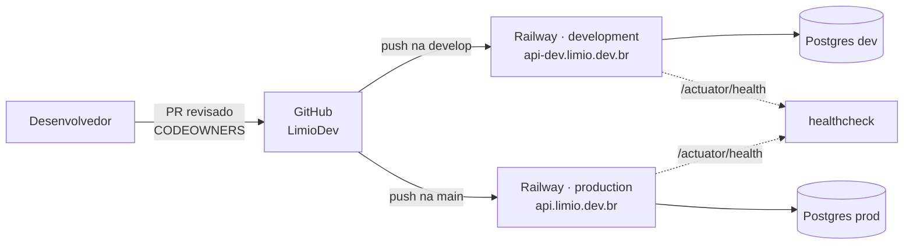

- Cada ambiente tem o próprio banco e as próprias variáveis (chaves do JWT, do HMAC do CPF, do Resend e do storage).
- O Flyway aplica as migrations ao subir. Fora de produção, o envio de e-mail fica desligado (`EMAIL_ENVIAR=false`) e o conteúdo só vai para o log.
- Fluxo de trabalho: uma branch `feature/<nº do card>` por card do Jira, pull request revisado e merge na `develop`.

## 13. Decisões e alternativas

| Decisão | Alternativa descartada | Por quê |
| --- | --- | --- |
| Monolito modular (um deploy, módulos isolados) | Microsserviços | Time de 5 pessoas e prazo de semestre: um deploy só é mais simples de operar. O isolamento por módulo permite separar um serviço depois, se precisar. |
| Módulos por domínio | Camadas técnicas globais (controller/service/repository) | Fica claro o que pertence a cada parte do negócio. |
| Eventos + portas entre módulos | Importar classes de outro módulo | Evita acoplamento escondido. |
| `record` + Bean Validation; Zod no app | DTO mutável com Lombok | Imutável e validado na criação. |
| Links `https` com páginas web | Link `limio://` direto no app | Clientes de e-mail bloqueiam esquemas próprios e não funciona sem o app. |
| Chat por WebSocket na própria API | Serviço de chat externo | Menos uma dependência e as regras (somente leitura, quem pode falar) ficam no mesmo lugar. |
| Railway | Infra própria em nuvem | Deploy por branch sem configuração de servidor. |

Registro completo das decisões: [ADRs](adr/).

## 14. Pontos em aberto

- Provedor de SMS para o código de confirmação do telefone.
- Provedores de push e WhatsApp para as notificações.
- Gateway de pagamento da assinatura GOLD.
- Como o administrador entra no sistema.
- Publicação da documentação OpenAPI da API.
